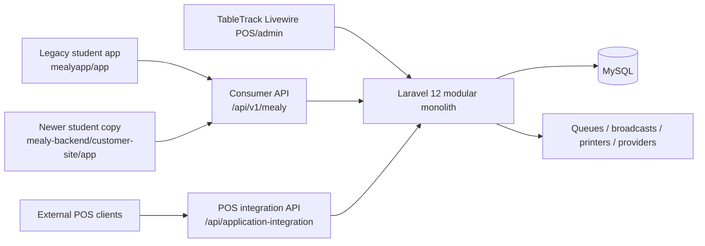
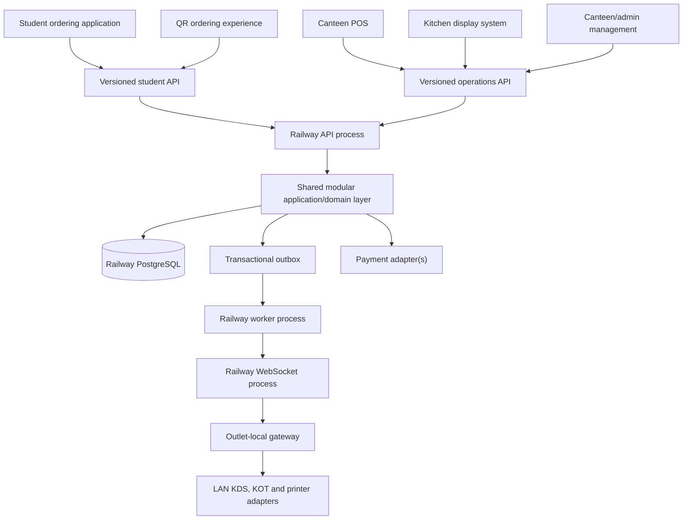

# Architecture

## Current legacy topology (observed)

Verified legacy facts:

- PHP 8.2 and Laravel 12 backend.
- MySQL is the `.env.example` default.
- Livewire/Blade/Vite implement the existing web POS and management interface.
- Consumer and POS APIs both reuse the backend's existing restaurant, branch, menu, order, KOT, payment, and user models.
- Mealy capabilities are isolated in modules, but some changes also exist as core TableTrack overrides.

## Adopted target boundaries

The application boundaries, clean frontend direction, PostgreSQL database foundation, Railway deployment target, and backend-owned WebSocket transport are adopted. The initial cloud backend is Node.js/TypeScript with Fastify; frontend framework choices outside the existing applications remain **TBD**.

## Architectural rules

- One backend owns catalog, availability, price calculation, order creation, token assignment, KOT linkage, payment state, and fulfillment state.
- POS, KDS, student/QR ordering, and admin are separate clients. They share contracts and design primitives where useful, but not application state or direct database access.
- Firebase is not the Mealy application backend. Frontends communicate through versioned Mealy APIs.
- Each optional capability is a module resolved through effective per-canteen entitlements and configuration. Platform admin owns assignment; delegated canteen admins may configure only enabled modules.
- Entitlement checks occur in backend policies/services before domain actions. Frontends consume an effective-capabilities response to build routes, navigation, and controls, but that response is not the security boundary.
- Keep KOT routing and KDS presentation separable: printed KOT workflows can operate without the KDS client, while KDS requires the KOT capability.
- Frontends may optimistically render but may not authoritatively calculate totals or invent status transitions.
- Keep campus/canteen/branch scoping explicit on every operational query and mutation.
- Use server-side authorization, not hidden UI controls, for permissions.
- Make order creation idempotent and payment verification server-to-server/signature-verified.
- Record state transitions and high-risk admin actions in an audit-capable history.
- Publish student status updates from committed backend transitions; do not let POS and student clients independently infer them.
- Keep provider integrations behind adapters so OTP, payment, real-time, and printing can change without rewriting domain logic.
- Use the implemented transactional outbox as the reliable boundary for notifications, cloud-to-gateway delivery, and KOT side effects.
- Railway hosts the authoritative modular backend, PostgreSQL database, WebSocket delivery process, and background worker. The backend is the only cloud writer for operational records.
- Keep PostgreSQL on Railway's private network and never expose database credentials to student, POS, KDS, or admin clients.
- Do not create feature-specific microservices for menu, orders, payments, tokens, or KOTs at the initial expected scale. Separate deployment processes only for API, persistent WebSockets, and background work.
- Each operating outlet has a local gateway with a durable store and sync outbox. It routes online orders received from the cloud to the LAN KDS/POS/printers, accepts offline counter orders, and synchronizes automatically after reconnect; day-end reconciliation is fallback-only.

## Repository target

All future code must be created under `mealy-platform/`, with separate `apps/student-web`, `apps/pos`, `apps/kds`, `apps/admin`, and `apps/backend` applications plus optional shared packages. QR ordering should initially be a dedicated route/mode in `student-web` unless later requirements justify another deployable app. The database lives at `apps/backend/database`, and the cloud backend uses Node.js, TypeScript, and Fastify. Frontend framework choices, the workspace package-manager strategy, and whether any Laravel logic is ported remain **TBD**. Do not import the ProBills/Firebase application; use it only as a read-only workflow reference.

## Database implementation

The database uses seven ordered SQL migrations covering identity/RBAC, campus/canteen/outlet tenancy, catalog/pricing/tax/inventory, orders/tokens/KOT, payments/promotions/wallet/platform finance, POS/admin operations, and reliability/audit functions. A transactional outbox is the adopted boundary for reliable order-status and KOT side effects.

## Deployment

Railway is selected for the cloud backend and PostgreSQL. The initial production shape is one modular backend codebase run as an API process, a persistent WebSocket process, and a background/outbox worker, with one PostgreSQL service. Begin with one replica of each process; add API replicas for measured load or availability, and introduce shared Redis/pub-sub only when multiple replicas need cross-instance coordination. Student/QR/admin web builds may use Vercel or Cloudflare Pages.

The operational deployment checklist and responsibility map live in `docs/DEPLOYMENT.md`.

The first outlet gateway remains a Node.js/TypeScript service using Fastify and a WAL-mode SQLite operational store. Its cloud client keeps one authenticated outbound WebSocket connection, persists pushed payloads before acknowledgement, and resumes from its last accepted event sequence after reconnecting. Runtime files and Docker wiring now exist; execution/testing, OS service packaging, object storage, domains, CI/CD, backup/PITR/restore, monitoring, production gateway enrollment, and production LAN security still require validation, implementation, or final selection.
