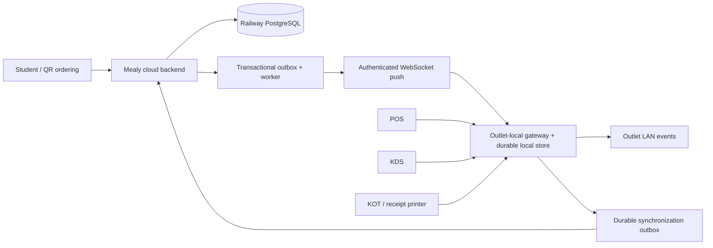

# Operational Connectivity and Offline Sync

## Status

- Status: **Confirmed on 2026-09-21**
- Scope: Railway cloud backend/PostgreSQL, backend-owned WebSockets, outlet-local POS/KDS/KOT operations, tokens, and connectivity recovery.

## Core model

Mealy uses an authoritative modular cloud backend and PostgreSQL database hosted on Railway. The backend owns business rules, identity/session handling, tenant access, entitlements, pricing, orders, token allocation, payment/webhook processing, KOT lifecycle, fulfilment transitions, and real-time delivery. Clients never connect to PostgreSQL directly.

Each outlet also runs an outlet-local gateway. It owns a local durable operational store and a retryable synchronization outbox so counter operations, KDS, and KOT printing continue when the internet fails. POS, KDS, printers, and the local gateway communicate over the outlet LAN; kitchen operations must not depend on an internet round trip.

## Online orders

1. The student/QR client submits the order to the cloud backend.
2. The backend validates authorization, availability, totals, payment and order rules, then commits the order and an outbox event atomically.
3. The worker delivers the complete committed order/event payload through the outlet gateway's authenticated WebSocket connection; the gateway never polls to discover new orders.
4. The outlet gateway persists the order locally before acknowledging, broadcasting it over the LAN to POS/KDS, and printing/routing the KOT.
5. Acknowledgements, state changes, and retries use idempotency/replay keys. If disconnected, the cloud retains undelivered events; after reconnecting the gateway supplies its last accepted sequence/cursor and receives missed events in order.

## Offline counter orders

1. The POS submits the order to the outlet-local gateway, which first saves it locally with a globally unique order ID and idempotency key.
2. The local gateway issues the KOT and updates the LAN KDS/printer without contacting the cloud.
3. The gateway records every uploadable action in its durable sync outbox.
4. On reconnect, it synchronizes automatically and repeatedly until acknowledged. It may batch requests to reduce network overhead, but it must not wait for a day-end manual job.
5. Day-end reconciliation compares local and cloud records and flags exceptions; it is a safety net, not the primary synchronization mechanism.

## Token allocation

Tokens remain unique within an outlet/counter/service-date scope. The cloud pre-reserves token blocks for each outlet terminal/gateway while connected; the gateway consumes only its assigned blocks when offline and reports every consumed token when it reconnects.

Do not use one rigid global split such as online `1-500` and offline `501-1000`. It wastes capacity when one channel is busy. Block size, low-water replenishment, counter ownership, customer-facing token format, and exhaustion behavior are **TBD** and must be load-tested before launch.

## Real-time and consistency rules

- Use committed backend events and the transactional outbox; never let individual clients infer or authoritatively create order state.
- The Railway backend owns authenticated, tenant-scoped WebSocket delivery. Payloads include enough canonical operational data for the gateway to persist and act without a follow-up fetch; clients use API refresh/recovery endpoints only for initial hydration, explicit recovery, or detected version gaps.
- WebSocket delivery is an optimization over the durable database/outbox, not the source of truth. Every consumer deduplicates by event ID/version and can resume from a cursor.
- Local LAN transport is the fast path for POS, KDS, and printers. It is separate from cloud/client real-time delivery.
- Offline orders may use cached catalog/pricing data only under an approved stale-data policy. Price, stock, payment, refund, promotion, and conflict outcomes must be reconciled explicitly and never silently overwritten.
- Every KOT, print attempt, order transition, payment attempt, and sync upload must be idempotent and auditable.

## Still to decide before implementation

- Backend and gateway runtimes are now Node.js/TypeScript with Fastify; Docker/runtime verification and outlet-gateway operating-system service/installer packaging remain.
- Final student/staff authentication providers and session UX; the Mealy backend owns session validation and authorization regardless of provider.
- Railway PostgreSQL production sizing, connection pooling, high availability, backup/PITR, off-platform logical dumps, restore drills, and monitoring.
- Object storage/CDN provider for menu images and uploaded files.
- Gateway enrollment, certificate/key rotation, LAN security, and support/monitoring.
- Cached menu/price/inventory freshness, offline payment methods, and conflict-resolution policy.
- Token block allocation policy, outlet capacity limits, and outage/load-test targets.
