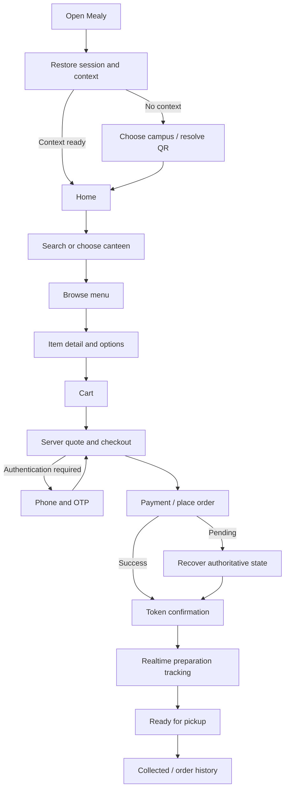

# Student Web Product and Design Plan

## Status and implementation boundary

- **Planning approved on 2026-10-22; responsive web implementation is in progress and is prioritized before native Android/iOS.**
- Build the production student application at `apps/student-web` inside `mealy-platform`.
- Keep `../mealyapp/app` read-only. It covers useful earlier flows, but targets the legacy `dashboard.mealy.in/api/v1/mealy` contract and contains unrelated uncommitted work.
- Use the supplied food-app screenshot only for hierarchy, browse density, image-led discovery, and quick add-to-cart inspiration. Do not copy its logo, green palette, imagery, brand shapes, or exact composition.
- Use only the approved Mealy wordmark from `apps/pos/src/assets/mealy-logo.png`. Catalog and canteen images must come from the Mealy backend; show a neutral branded placeholder when media is absent.
- Connect only to the new versioned Mealy backend. No local menu/order fallbacks and no direct PostgreSQL access.

## Product goal

Let a student enter the correct campus/canteen context, find available food quickly, customize and place a pickup order safely, follow its live preparation state, and collect it using a prominent token. The interface must feel native and focused on a phone while becoming a genuine information-rich web workspace on a laptop.

## Experience principles

1. **Phone first, not phone only:** design the primary one-handed flow at 360-430 px, then deliberately recompose at tablet and desktop breakpoints.
2. **Order confidence:** always make canteen, pickup context, total, payment state, order state, and token explicit.
3. **Fast campus use:** minimum 44 px targets, short paths, sticky actions, readable sunlight contrast, and no decorative motion that delays ordering.
4. **Mealy consistency:** use the platform's warm orange, dark slate, near-white surfaces, light borders, rounded controls, and clear status language.
5. **Dynamic truth:** loading, empty, unavailable, expired, offline, and error states replace fabricated records.
6. **Motion with meaning:** animation explains navigation, hierarchy, continuity, and status change. It never hides latency or invents completion.
7. **Accessible by default:** keyboard support on desktop, visible focus, semantic landmarks, screen-reader announcements, non-color status cues, and reduced-motion behavior.

## Visual language

| Role | Direction |
| --- | --- |
| Logo | Approved orange Mealy wordmark only; no logo from the reference or legacy student app |
| Primary action | Existing Mealy orange, provisionally `#F4511E` |
| Text/canvas | Deep slate text on warm near-white and quiet slate-tinted sections |
| Cards | White, light slate border, controlled soft shadow; stronger elevation only for interactive layers |
| Status | Color plus icon and explicit text; never color alone |
| Typography | Existing system/UI font stack; no unrelated font |
| Imagery | Backend-provided food/canteen media only; branded placeholder when absent |
| Iconography | One consistent outlined family, 2-2.5 px stroke; filled only for selected navigation |

- Use a 4 px base spacing rhythm with primary steps at 8, 12, 16, 20, 24, 32, and 48 px.
- Mobile cards use 16-20 px radii and sheets 24-28 px top radii.
- Desktop uses slightly tighter 14-18 px radii, restrained shadows, and denser spacing.
- Avoid wrapping every section in a floating rounded card; whitespace and dividers should carry hierarchy.

## Responsive compositions

### Phone: 360-599 px

- Compact app bar with campus/canteen context, search, and profile/notifications.
- Bottom navigation: Home, Search, Orders, Profile.
- Image-led discovery feed and horizontally scrollable categories.
- Menu page uses a sticky category strip and persistent cart summary above bottom navigation.
- Item customization, filters, campus choice, and lightweight confirmations use bottom sheets.
- Cart and checkout are full pages for pricing/payment clarity.
- Include safe-area padding for installed/PWA use.

### Tablet: 600-1023 px

- Two-column discovery/menu grids.
- Navigation rail or expanded bottom navigation depending on orientation.
- Item details may open as a wide sheet with media and configuration columns.
- Cart remains available as a compact side panel in landscape.

### Laptop/desktop: 1024 px and above

- Full-width responsive shell, not a centered phone mockup.
- Persistent left navigation/context rail, flexible main workspace, and optional right contextual rail.
- Home: discovery in the main column; active/recent order or cart summary in the right rail.
- Canteen: categories on the left, searchable menu grid in the center, live cart on the right.
- Checkout: forms/payment on the left and sticky order summary on the right.
- Orders/profile: desktop tables or master-detail panels where scanning benefits from density.
- Constrain readable content, not the entire app; use width intentionally through 1440-1600 px.

## Information architecture

Primary navigation: Home, Search, Orders, Profile.

Contextual destinations: campus/canteen chooser, canteen menu, item customization, cart, checkout, payment result, confirmation, active tracking, order detail, QR resolution, and help.

Module-gated destinations: wallet, coupons/offers, online payments, feedback/ratings, and favorites. These appear only when backend entitlement and launch scope allow them; their presence in the legacy app does not make them MVP scope.

## Complete screen plan

### 1. Startup and session restoration

- Branded splash using the approved wordmark on a warm neutral canvas.
- Restore session, campus context, cart, and active order in parallel.
- A short minimum display prevents flashing, but startup never waits on decorative animation.
- Outcomes: authenticated home, campus selection, sign-in continuation, offline recovery, or safe startup error.

### 2. Welcome/onboarding

- First-run explanation: browse, order, collect with a token.
- One primary action and smaller sign-in/continue option according to approved auth policy.
- Use typography, Mealy shapes, and product UI fragments—not stock illustrations.

### 3. Authentication

- Phone entry, OTP verification, resend timer, wrong/expired OTP, rate limiting, profile-name completion, and success.
- Desktop uses a two-panel brand/value plus focused form composition, not a stretched mobile card.
- Guest/campus identity options stay hidden until approved.

### 4. Campus and pickup context

- Restore last campus, searchable campus/canteen selection, closed/unavailable context, and QR-resolved context.
- Make the preparation and collection location explicit before browsing.
- Context switch warns before clearing or separating a cart from another outlet.

### 5. Home/discovery

- Context header, global search, active-order status, categories, open canteens, backend-supplied recommendations/popular items, recent order shortcut, and operational notices.
- Empty state for a campus with no available canteen/menu.
- Desktop uses a discovery grid plus active-order/recent-context rail.

### 6. Search and filters

- Search canteens and items; recent searches are harmless local preference data.
- Filters use only API-supported fields: canteen, category, dietary type, price, availability, and preparation time.
- Include initial, loading, no-results, partial-error, and offline states.

### 7. Canteen/menu

- Canteen context, open/closed state, expected preparation time, search, sticky categories, dietary information, price, availability, and quick add.
- Sold-out items remain understandable but cannot be added.
- Desktop becomes a three-part menu workspace: categories, menu grid, cart.

### 8. Item detail and customization

- Backend image/placeholder, description, dietary/allergen data when available, variants, required/optional add-ons, quantity, note, computed total, and add/update action.
- Required options block submission with inline explanation.
- Mobile uses a full-height sheet/page; desktop uses a focused panel without losing menu context.

### 9. Cart

- Grouped lines with customization, quantity, notes, availability revalidation, pricing summary, and pickup context.
- Handle changed price, sold-out items, changed options, and context mismatch before checkout.
- Empty cart returns directly to the correct menu.

### 10. Checkout

- Contact/auth state, pickup details, approved notes, server quote, tax/fee breakdown, payment method, terms, and idempotent place-order action.
- Never calculate authoritative totals only in the browser.
- Payment and KOT timing follow approved business rules.

### 11. Payment states

- Provider handoff, processing, pending, success, failure, cancelled, verification delayed, and retry/recovery.
- Reloading while pending recovers authoritative state and never creates another order.
- Pay-at-counter appears only when enabled.

### 12. Order success and token

- Token is dominant, followed by canteen, pickup counter, items, payment state, and next action.
- Provide clear “track order” and “view order” paths.
- Celebration is brief and accessible; success is not conveyed by confetti alone.

### 13. Active order tracking

- Backend lifecycle, timestamps, token, pickup instructions, and reconnect indicator.
- Realtime updates the view; API refresh handles recovery, not continuous order polling.
- Ready state emphasizes token and collection point.

### 14. Orders and order detail

- Active first, then history grouped by date.
- Show status, canteen, total, token, and time at scan level.
- Detail includes immutable order/pricing snapshot, payment state, timeline, permitted cancellation, support, and reorder only after catalog revalidation.
- Desktop uses list/master-detail.

### 15. Profile and settings

- Identity, current campus, notification preference, approved dietary preferences, help, legal pages, session/device management, and logout.
- Wallet, coupons, addresses, and feedback are gated; campus pickup does not inherit delivery-address UX by default.

### 16. QR entry

- Resolve signed context, display verified campus/outlet/counter, then enter the same browse flow.
- Handle invalid, expired, unauthorized, wrong-campus, offline, and unavailable-outlet states.

### 17. Global system states

- Offline/reconnecting, session expired, maintenance, unavailable feature, permission denied, stale cart, API error, empty catalog, closed outlet, and unexpected-render recovery.
- Each state gives the safest next action and preserves valid recoverable cart work.

## End-to-end flow

## Motion and shared-element specification

### Foundation

- Proposed implementation: `motion/react` route presence and `layoutId`; browser View Transitions can progressively enhance supported browsers.
- Use emphasized deceleration for arrivals, acceleration for exits, and spring only for direct manipulation.
- Timing: 120-160 ms micro-feedback, 180-240 ms controls/sheets, 260-360 ms page/shared-element transitions.
- Prefer transform and opacity; avoid expensive layout animation on long menus.
- `prefers-reduced-motion` removes travel, parallax, count-up, and celebration while preserving state changes and focus.

| Moment | Motion behavior | Purpose |
| --- | --- | --- |
| App launch | Wordmark resolves from soft mask/opacity; structural skeleton crossfades when data is ready | Brand recognition without blocking startup |
| Welcome -> auth | Action and form surface share position inside one stable frame | Preserve task continuity |
| Phone -> OTP | Phone becomes a compact summary; OTP cells enter sequentially; subtle safe error shake | Explain authentication progression |
| Campus selection | Selected context chip expands into the home header | Confirm ordering location |
| Home -> canteen | Image/placeholder, name, and status share into the menu header | Preserve spatial continuity |
| Item -> detail | Image/placeholder, name, and price expand while the list stays anchored | Make selection obvious |
| Add to cart | Button compresses, quantity resolves, badge increments briefly | Confirm addition quickly |
| Mobile cart | Cart bar expands into cart using shared count and total | Connect summary to detail |
| Desktop cart | Right rail updates in place with line insertion/height animation | Avoid unnecessary page travel |
| Checkout | Directional crossfade/slide inside a stable frame; summary remains fixed | Show progress and preserve price context |
| Payment | Honest determinate progress when available; calm indeterminate state otherwise | Avoid false success |
| Success/token | Checkout action transforms into token card; brief check/halo then stops | Emphasize pickup identity |
| Order status | Connector progresses and changed state highlights briefly; token stays stable | Communicate realtime change |
| Navigation | Shared selected indicator glides; page uses short fade/translate | Reinforce current destination |
| Sheets/dialogs | Scrim fades, sheet rises 16-24 px, dismissal follows touch | Direct-manipulation clarity |
| Loading | Structural skeleton matching final layout, never fake content | Reduce layout shift |
| Error/retry | Error enters without wiping content; retry shows inline progress | Preserve confidence |

Stable shared-element IDs:

- `canteen:{id}:image`, `canteen:{id}:name`
- `item:{id}:image`, `item:{id}:name`, `item:{id}:price`
- `cart:summary`, `cart:item-count`, `cart:total`
- `order:{id}:token`, `order:{id}:status`
- `campus:{id}:context`

If media is unavailable, the same branded placeholder participates in the transition.

## Component architecture

- Shell: `StudentAppShell`, `MobileBottomNav`, `DesktopNavigationRail`, `ContextHeader`, `ConnectionBanner`, `ActiveOrderDock`, `RouteTransitionBoundary`.
- Discovery: `GlobalSearch`, `CampusContextPicker`, `CanteenCard`, `CategoryScroller`, `CategoryRail`, `MenuItemCard`, `ItemConfigurator`.
- Commerce: `CartDock`, `CartRail`, `PriceBreakdown`, `PaymentMethodPicker`.
- Orders: `TokenCard`, `OrderTimeline`, `OrderStatusBadge`, `PickupInstructions`, `RealtimeConnectionState`.
- Feedback: structural skeletons, `EmptyState`, `InlineError`, `RetryBoundary`, `ToastRegion`, `ConfirmSheet`, `FeatureUnavailable`.

## Data and state architecture

- Generate or share versioned API contracts instead of copying response shapes into pages.
- Use a server-state cache with cancellation, stale-time policy, explicit invalidation, and recovery after realtime events.
- Persist locally only cart draft, recent searches, harmless UI preferences, and safe last context.
- Backend remains authoritative for availability, price, tax/fees, entitlements, payment, order, token, KOT, and fulfillment.
- Consume one authenticated order-event channel; deduplicate by event/version and refetch canonical state after gaps.
- Generate one idempotency key per checkout attempt and retain it across safe retries.
- Guard routes by session, campus/outlet context, module entitlement, and active checkout/order recovery.

## Route plan

| Route | Purpose |
| --- | --- |
| `/` | Startup resolver leading to home/context/welcome |
| `/welcome` | First-run onboarding |
| `/auth` | Phone/OTP authentication |
| `/campus` | Campus and canteen selection |
| `/search` | Global search and filters |
| `/canteens/:canteenId` | Canteen menu |
| `/canteens/:canteenId/items/:itemId` | Shareable item detail |
| `/cart` | Cart review |
| `/checkout` | Quote, pickup, and payment review |
| `/checkout/payment` | Provider/pending state |
| `/orders/:orderId/success` | Token confirmation |
| `/orders` | Active and historical orders |
| `/orders/:orderId` | Tracking and order detail |
| `/profile` | Account and preferences |
| `/help` | Support and FAQs |
| `/q/:signedContext` | QR context resolution |

Module-gated routes are added only when their backend capability is approved.

## Delivery phases

### Phase A: Foundation

- Scaffold `apps/student-web` with React, TypeScript, Vite, React Router, shared API boundary, query/state strategy, motion system, tokens, approved logo, error boundary, and responsive shell.
- Define breakpoint behavior and reusable loading/empty/error/offline states.
- Establish accessibility, reduced-motion, and visual-regression baselines.

### Phase B: Discovery

- Startup, welcome, campus context, home, search, canteen menu, item detail, and cart.
- Wire live catalog/context APIs; add missing backend contracts instead of fallback data.

### Phase C: Checkout

- Authentication, server quote, and the complete responsive checkout presentation first. Razorpay provider integration follows a separate approved payment plan with idempotent creation, server-side verification, pending recovery, and success/token release.

### Phase D: Fulfillment

- Active tracking, backend realtime, reconnect/version-gap recovery, pickup-ready state, history, and detail.

### Phase E: Account and gated modules

- Profile, help, sessions, notifications, and only approved wallet/coupon/feedback capabilities.

### Phase F: Verification and release preparation

- Phone/tablet/laptop visual pass; keyboard, screen-reader, reduced-motion, slow/offline/error, stale cart, duplicate submission, realtime reconnect, payment pending, and rush-load verification.
- PWA/install behavior only if explicitly approved.

## Completion criteria

- Every required page has mobile, tablet, and desktop behavior; laptop layouts are not scaled phone screens.
- Only the approved Mealy logo and backend-provided catalog/canteen media are used.
- Shared-element transitions cover context, canteen, item, cart, token, and order status.
- Animation respects reduced motion and never blocks critical action.
- No mock/fallback operational records appear at runtime.
- Loading, empty, closed, sold-out, offline, auth-expired, payment-pending, error, and retry states exist.
- Server quote and idempotency protect checkout; the client does not authoritatively price or duplicate orders.
- Realtime does not poll to discover orders and recovers safely after disconnect/version gaps.
- Core flows work at 360, 390/430, 768, 1024, 1280, and 1440+ px.
- Accessibility covers WCAG AA contrast, logical focus, desktop keyboard completion, labels/live announcements, and 44 px targets.

## Decisions still required before corresponding implementation

1. Phone OTP only is approved; the production SMS provider remains to be selected and configured.
2. Razorpay is approved for online-only student payment; the detailed verified-payment-to-order/KOT timing, pending recovery, refund, and failure rules still require the separate payment plan.
3. Exact campus/canteen scoping and signed QR behavior.
4. Launch inclusion of wallet, coupons, favorites, feedback, and notifications.
5. Student-facing status wording and cancellation rules.
6. Whether student web is installable as a PWA at launch.

These do not block foundation/discovery shell work, but they block their corresponding business flows.
